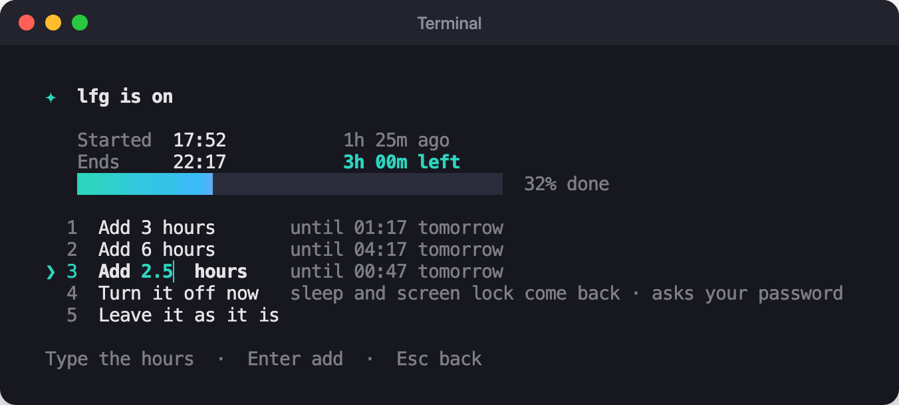

# lfg

**LFG = let's fucking go.** Type `lfg`, shut the lid, walk away. Your Mac keeps working, then goes back to normal by itself.

I wanted my laptop to stay awake with the lid shut while things kept running: a long download, a render, an AI agent working through the night. I tried `caffeinate`, I tried apps, and none of them did the whole job. So I made my own.

```
curl -fsSL https://raw.githubusercontent.com/udayanwalvekar/lfg/main/lfg.sh | bash
```

That's the whole install. You can also download [`lfg.sh`](lfg.sh) and run `bash lfg.sh`.

## How to use it

**Just type `lfg` and press Enter.** Type your Mac password once and it's on for 3 hours.


**Want a set number of hours?** Write the hours: `lfg 6` is 6 hours, `lfg 1.5` is an hour and a half.

**Already on?** Type `lfg` again. It shows when it started, when it ends and how much time is left, then lets you add 3 hours, 6 hours or any number you type, turn it off, or leave it. Adding time needs no password.




**Done early?** `lfg off`.

## lfg vs caffeinate

`caffeinate` is the command that comes with every Mac. lfg uses it inside, and adds what it doesn't do:

| | `caffeinate` | `lfg` |
|---|---|---|
| Lid shut | The Mac still goes to sleep (unless it's plugged into a monitor) | The Mac stays awake |
| Screen lock | Not touched | Off while it runs, then back the way you had it |
| How long | Only while the command runs: close that Terminal window and it stops | A timer that keeps going after you close the window, and that you can extend |
| At the end | Stops keeping the Mac awake | Puts sleep and the screen lock back by itself |
| Password | None | Once to start, once to stop. Keeping the Mac awake with the lid shut is a system setting, so macOS asks |

**Needs:** a Mac, an admin account on it (you type your Mac password to start and to stop), and Python 3.9 or newer (it comes with Apple's Command Line Tools: `xcode-select --install`).

The installer puts the program in `~/.local/share/lfg` and the `lfg` command in a folder already on your PATH. It changes no Mac settings. (Only if no suitable folder is on your PATH does it add `~/.local/bin` to it, in `~/.zshrc`, or `~/.bash_profile` if your shell is bash.)

## Commands

| Type | What happens |
|---|---|
| `lfg` | On for 3 hours. Asks your Mac password once. |
| `lfg 6` | On for 6 hours from now. Never cuts a longer run short. |
| `lfg` (while on) | Shows when it started, when it ends and how long is left, then lets you add 3 hours, 6 hours or any number you type, turn it off, or leave it. |
| `lfg +2` | Adds 2 hours to the current end. No password while it's on. |
| `lfg off` | Off now: sleep and your screen lock come back. Asks your password. |
| `lfg status` | Says whether it is on and until when. Changes nothing. |
| `lfg update` | Gets the newest lfg. A run that is on keeps going. |
| `lfg uninstall` | Removes lfg. If a run is on or left something off, it asks you to run `lfg off` first. |

## What it does

While it's on, the Mac doesn't sleep when you close the lid, stays on Wi-Fi, and doesn't lock its screen. When the time is up, lid sleep comes back by itself and a Terminal window asks for your password to put the screen lock back the way you had it (if you keep it off, there's no window and it stays off). If that window doesn't show up, run `lfg off`.

- **Anyone who opens the lid gets in without a password while it's on.** Keep the laptop with you, or turn lfg off before you leave it somewhere.
- Don't put the Mac in a bag while it's on: a closed laptop that stays awake gets hot.
- Adding time needs no password, so an agent can run `lfg +3` while you're away. That also means any program on your Mac can push the end time out, up to 72 hours ahead.
- If the Mac restarts during a run, lid sleep stays off until you run `lfg off`. `lfg status` tells you when that's the case.
- Every step is written to `~/.lfg/log`. Your password never is.

## Remove it

```
lfg off
lfg uninstall
```

This removes the program, the `lfg` command and `~/.lfg`.

## Licence

MIT
